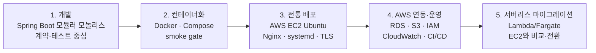
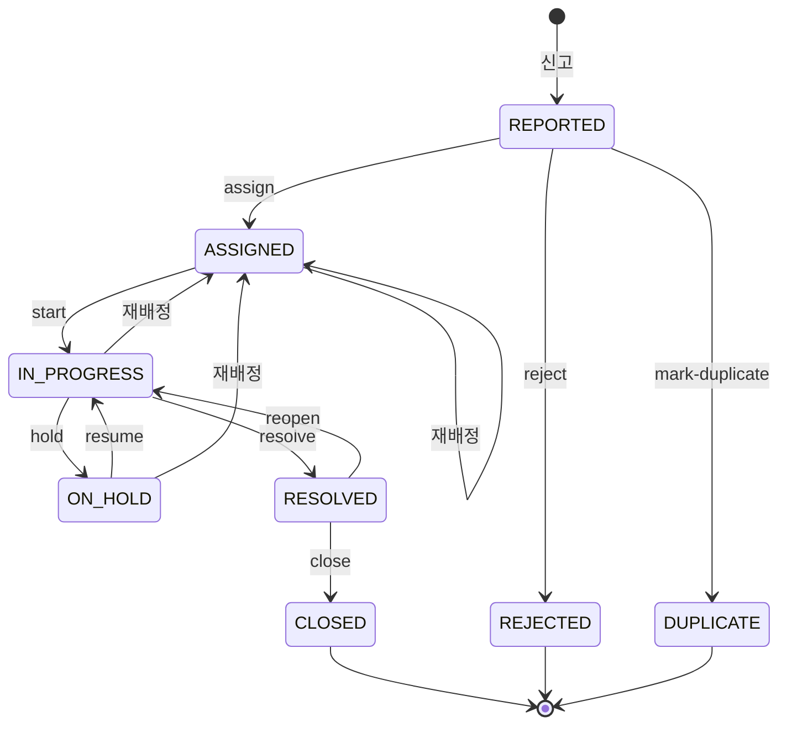

# DormFix

> 기숙사 시설 고장을 **신고 → 배정 → 방문 → 수리 → 확인**까지 한 흐름으로 관리하는 백엔드 서비스

DormFix는 대학 기숙사의 객실·공용시설 고장을 다루는 유지보수 workflow 플랫폼입니다. 입주자는 고장을
신고하고 진행 상황을 확인하며, 관리자는 신고를 분류·배정하고, 작업자는 방문 일정을 잡고 수리합니다.
지금은 전화, 게시판, 메신저로 흩어진 신고를 상태와 권한이 분명한 하나의 기록으로 모으는 것이 목적입니다.

## 이 프로젝트의 목표: 개발부터 운영, 마이그레이션까지

DormFix는 기능 하나를 만드는 데서 끝나지 않습니다. **한 서비스를 직접 설계·구현하고, 실제 서버에 띄워
운영하고, 서버리스로 옮기기까지** 백엔드 엔지니어의 전체 수명주기를 한 프로젝트에서 익히는 그랜드
프로젝트입니다.



| 단계 | 익히는 것 |
|---|---|
| 개발 | 도메인 모델링, 상태 기계, 인가, 트랜잭션 경계, 낙관적 잠금, Flyway, Testcontainers, ArchUnit |
| 컨테이너화 | 이미지 빌드, Compose 기반 로컬 운영 환경, 통합 smoke 검증 |
| 전통 배포 | SSH, apt, systemctl, journalctl, Nginx reverse proxy, TLS, 재부팅 복구를 손으로 직접 |
| AWS 연동·운영 | VPC·Security Group, RDS 백업·PITR, S3 presigned URL, IAM 최소 권한, 로그·알람, OIDC 기반 CD, 롤백 |
| 서버리스 마이그레이션 | 진입점만 바꾸고 도메인은 유지하는 이전, cold start·연결 수·비용 비교, 병행 운영 후 전환 |

처음부터 서버리스로 시작하지 않는 데는 이유가 있습니다. 서버를 직접 운영해 봐야 managed 서비스가 무엇을
대신해 주는지, 그 대가가 무엇인지 비교할 수 있습니다. 그래서 EC2 운영의 응답 시간·비용·운영 부담을
기록해 두고, 서버리스 전환 뒤 같은 기준으로 비교합니다.

## 진행 현황

| Phase | 내용 | 상태 |
|---|---|---|
| 0 | Foundation: 구조 규칙, Frozen 명세, CI, Docker, ADR | ✅ 완료 |
| 1 | 인증: 회원가입, 로그인, RS256 JWT, refresh 토큰 교체, 로그아웃 | ✅ 완료 |
| 2 | 구조 데이터: 기숙사·건물·공간·시설·카테고리, 거주 | ✅ 완료 |
| 3–4 | 신고 핵심: 생성·조회, 배정, 상태 전이, 낙관적 잠금 | ✅ 완료 |
| 5 | Workflow 완성: 방문, 작업 기록, 댓글, 첨부, 이력, 알림 | 🔶 관리자 사용자 목록·대시보드 남음 |
| 6 | Docker 통합 정리와 운영 migration 실행 방식 | 🔶 부분 완료 |
| 7 | AWS EC2 전통 배포 | ⏳ 예정 |
| 8 | RDS·S3·IAM·CloudWatch 연동, 실제 S3 adapter | ⏳ 예정 |
| 9 | CI/CD (main 병합 → 이미지 → 배포 → health check → 롤백) | ⏳ CI만 있음 |
| 10 | 운영 안정화: 백업 복구 연습, 부하·보안 테스트, 지표 기록 | ⏳ 예정 |
| 11 | 서버리스 마이그레이션 (착수 전 ADR 승인 필요) | ⏳ 예정 |

단계별 범위와 완료 기준은 [roadmap](docs/development/roadmap.md)에 있습니다.

## 핵심 workflow

신고 상태는 이름 있는 명령(command)으로만 바뀝니다. 상태를 직접 지정하는 API는 없고, `SUPER_ADMIN`도
종료 상태를 되돌릴 수 없습니다.



| 역할 | 할 수 있는 일 |
|---|---|
| RESIDENT | 자기 방 고장 신고, 자기 신고 조회·수정(접수 상태일 때), 공개 댓글, 해결된 신고 확인(close)·재오픈 |
| WORKER | 배정된 신고의 작업 시작·보류·재개·해결, 방문 관리, 작업 기록, 직원 전용 댓글 |
| ADMIN | 담당 기숙사의 신고 분류·배정·반려·중복 처리, 시설 관리, 거주 등록 |
| SUPER_ADMIN | 전체 기숙사 구조·카테고리 관리, 전역 조회 |

정확한 권한과 상태 규칙은 [permission/state matrix](docs/product/permission-state-matrix-v1.md)가 기준입니다.

## 구현된 기능

모든 API는 `/api/v1` 아래에 있고 Bearer JWT로 인증합니다.

| 영역 | 내용 |
|---|---|
| 인증 | `signup`, `login`, `refresh`(토큰 교체), `logout`, `GET /me` |
| 구조 조회·관리 | 기숙사·건물·공간·시설·카테고리 조회, 관리자 생성·수정·비활성화·재활성화 |
| 거주 | 입주 등록·퇴거, 관리자 목록, 내 거주 이력 |
| 신고 | 생성, 범위 기반 목록·상세(볼 수 없으면 404), 정보 수정(PATCH, version 필수) |
| 배정·상태 전이 | 배정·재배정, `start`/`hold`/`resume`/`resolve`/`close`/`reopen`/`reject`/`mark-duplicate` |
| 방문 | 일정 잡기·변경·취소, 완료, 부재(no-access) |
| 작업 기록 | append-only WorkLog (현재 담당자만 작성, 직원만 조회) |
| 댓글 | `PUBLIC`/`STAFF_ONLY`, soft delete (입주자는 직원 전용 댓글의 존재도 알 수 없음) |
| 첨부 | presigned URL 계약과 메타데이터 (실제 S3는 Phase 8, 지금은 503으로 명시적 실패) |
| 이력 | 신고별 RequestHistory 조회, 상태 전이 사유 보관 |
| 알림 | 명령 커밋 뒤 이벤트로 생성되는 알림, 목록·읽음·전체 읽음·안 읽은 개수 |

## 기술 스택

| 영역 | 사용 기술 |
|---|---|
| 언어·프레임워크 | Java 21, Spring Boot 3.5, Spring Security(OAuth2 Resource Server, RS256 JWT), Spring Data JPA |
| 데이터 | PostgreSQL 17, Flyway (V1~V14) |
| 테스트·품질 | JUnit 5, Testcontainers, ArchUnit, Checkstyle, 저장소 계약 검사 스크립트 |
| 런타임 | Docker, Docker Compose |
| CI | GitHub Actions (Java 검사 + PostgreSQL 통합 테스트, Docker 빌드 + local-stack smoke) |
| 배포 목표 | AWS EC2 Ubuntu + Nginx → RDS·S3·IAM·CloudWatch → 서버리스 (계획) |

## 아키텍처 원칙

- **모듈러 모놀리스, package-by-feature.** `identity`, `location`, `catalog`, `maintenance`,
  `notification`이 각각 `api → application → domain` 계층을 갖고, `infrastructure`가 port를 구현합니다.
  Controller는 repository나 트랜잭션을 직접 다루지 않습니다. ArchUnit이 이 의존 규칙을 검사합니다.
- **명령 기반 상태 전이.** `MaintenanceRequest`만 자기 상태를 바꾸고, public status setter가 없습니다.
- **한 명령, 한 트랜잭션.** 상태 변경, 배정 변경, RequestHistory가 함께 커밋됩니다. 트랜잭션 안에서
  네트워크 호출을 하지 않습니다.
- **낙관적 잠금.** JPA `@Version`과 요청의 `version`을 비교하고, 경합은 `409 VERSION_CONFLICT`입니다.
  부분 unique index가 "활성 배정은 하나"를 DB에서도 보장합니다.
- **관계 기반 인가.** 역할만이 아니라 그 신고에 대한 관계(신고자, 현재·과거 담당자, 담당 기숙사)를
  봅니다. 보이지 않는 자원은 404로 답해 존재 여부를 숨깁니다.
- **커밋 뒤 부수 효과.** 알림은 `AFTER_COMMIT` 이벤트로 별도 트랜잭션에서 기록합니다. V1은 best-effort이고,
  V2에서 Outbox → SQS로 확장할 지점을 문서로 남겼습니다.
- **Flyway가 스키마의 유일한 주인.** 적용된 migration은 고치지 않습니다.

자세한 내용은 [architecture overview](docs/architecture/overview.md)와
[backend architecture](docs/architecture/backend-architecture.md)를 보세요.

## 일하는 방식

혼자 하는 프로젝트지만 팀 프로젝트처럼 결정과 검증을 남깁니다.

- **Frozen 계약.** `docs/product/`의 API·ERD·권한 명세는 고정되어 있고 해시로 보호됩니다. 명세가 비어
  있으면 추측해서 구현하지 않습니다.
- **ADR 우선.** 공백은 근거 → Proposed ADR → 대안과 장단점 → 사람 승인 → 명세·해시 동기화 → 구현 순서로만
  닫습니다. 지금까지 [ADR 29개](docs/adr/README.md)가 있습니다.
- **Vertical slice.** 기능 하나를 API부터 migration, 테스트, 문서까지 한 브랜치(`feature/<use-case>`)에서
  끝내고 PR로 병합합니다. 계층별 브랜치는 쓰지 않습니다.
- **품질 게이트.** 저장소 검사, 단위 테스트·ArchUnit·Checkstyle, Testcontainers 통합 테스트가 모두
  통과해야 완료입니다. 돌리지 못한 검사는 통과로 치지 않습니다.
- **작업 기억.** [`PROJECT_CONTEXT.md`](PROJECT_CONTEXT.md)는 현재 상태와 확정 결정,
  [`WORKLOG.md`](WORKLOG.md)는 작업마다의 기록과 검증 결과입니다.

## 로컬에서 실행하기

필요한 것: Java 21, Docker(Compose 포함), Python 3. Gradle은 wrapper를 쓰므로 따로 설치하지 않습니다.

1. `.env.example`을 `.env`로 복사하고 로컬 전용 `POSTGRES_PASSWORD`와 JWT 키 값을 채웁니다. 키 형식과
   만드는 방법은 [로컬 개발 가이드](docs/development/local-development.md)에 있습니다. 실제 비밀값은
   커밋하지 않습니다.
2. 실행하고 상태를 확인합니다.

```sh
docker compose config --quiet
docker compose up --build -d --wait --wait-timeout 180
curl --fail http://127.0.0.1:8080/actuator/health/liveness
curl --fail http://127.0.0.1:8080/actuator/health/readiness
```

PostgreSQL은 persistent volume과 loopback 5432, 애플리케이션은 loopback 8080을 씁니다. 로컬에서는 시작할
때 Flyway가 migration을 실행합니다. 종료는 `docker compose down`이며 데이터는 남습니다. 평소에는
`down -v`를 쓰지 않습니다.

## 검증

```sh
python3 scripts/check_repository.py
cd backend
./gradlew check bootJar
./gradlew integrationTest
```

`integrationTest`는 Docker가 필요하며, Docker가 없으면 건너뛰지 않고 실패합니다. CI도 같은 검사를
필수 병합 조건으로 돌립니다.

## 저장소 구조

| 경로 | 내용 |
|---|---|
| `backend/` | Spring Boot 애플리케이션, 단위·아키텍처·통합 테스트, Flyway migration |
| `docs/product/` | Frozen API·ERD·권한·상태 명세 |
| `docs/architecture/`, `docs/adr/` | 아키텍처 결정과 ADR, 미해결 질문 기록 |
| `docs/development/`, `docs/operations/` | 로드맵, 작업 규칙, 테스트 전략, 배포·롤백 runbook |
| `infra/` | 운영용 Compose, Nginx, systemd 템플릿 (아직 배포하지 않음) |
| `frontend/` | 보류 중인 최소 client 경계 |
| `scripts/` | 저장소 계약 검사 |
| `.github/` | CI, Dependabot, PR 템플릿 |
| `AGENTS.md` | 엔지니어링 규칙과 필수 게이트 |

코드를 바꾸기 전에 [AGENTS.md](AGENTS.md)와 [문서 색인](docs/README.md)을 먼저 읽습니다.

## 보안 원칙

- 비밀값은 환경 변수나 secret store에만 둡니다. 비밀번호, 토큰, 출입 동의, 직원 전용 댓글, presigned URL은
  로그에 남기지 않습니다.
- 운영 템플릿에는 실제 도메인, 리전, ARN, 자격 증명이 없습니다. 실제 AWS 리소스는 각 단계에서 명시적으로
  승인한 뒤에만 만듭니다.
- 에러 응답은 고정된 400/401/403/404/409 의미와 표준 본문(`code`, `traceId`, `fieldErrors`)을 따르고 내부
  예외를 노출하지 않습니다.
